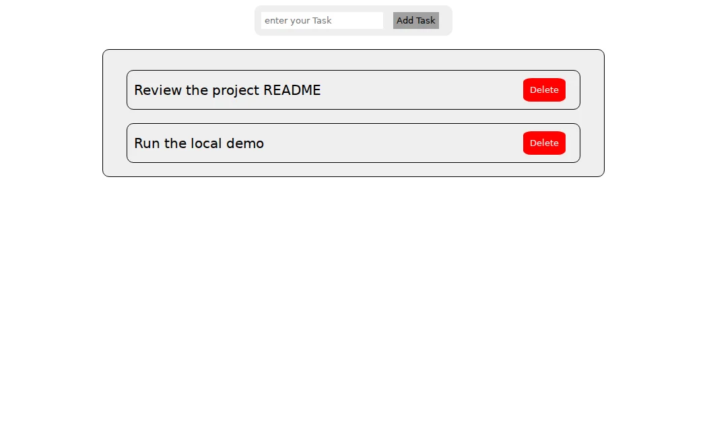

# To-Do List

A small vanilla JavaScript exercise in DOM events and browser storage. Add and delete tasks, then reload to see them restored from local storage.

[Open the live demo](https://amr546214.github.io/TO_Do_List/)



## Run locally

Open [`index.html`](index.html) in a browser, or serve this folder with Python 3.

```bash
python3 -m http.server 8000
```

Visit `http://localhost:8000`. SweetAlert2 is loaded from a CDN for the empty-input alert. The [JavaScript](app.js) handles validation, rendering, and persistence.
